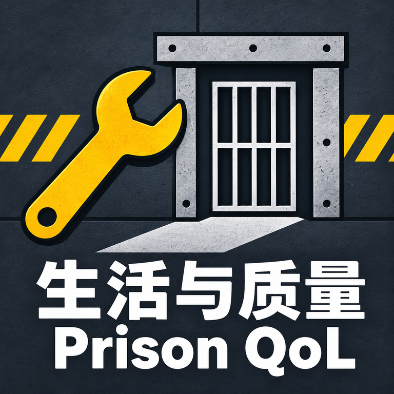

# Prison Quality of Life 1.6.10

[简体中文](README.md)



A Windows patch manager for Prison Architect. It supports **Steam x64 build 10630057** with the stock executable, Tyr 1.5.0's default fixes, and those fixes with Tyr's optional staff-morale tweak. Apply your choices in the manager, then launch the game through Steam as usual.

## Download and installation

### From GitHub

1. Save your prison and close the game.
2. Download and extract **Prison-QoL-1.6.10-Windows-x64.zip**, then open **Prison QoL.exe**. [GitHub release 1.6.10](https://github.com/Zack176CN/prison-quality-of-life/releases/tag/v1.6.10)
3. Check the detected Steam path and game build. To select it yourself, right-click Prison Architect in the Steam Library and choose **Manage → Browse local files**. Point the manager to the folder containing `Prison Architect64.exe`.
4. Select the options you want and click **Apply**. After the manager confirms the change, close it and launch through Steam.

### From Steam Workshop

1. Subscribe to the Workshop item and launch the game once. When **Prison Quality of Life** appears under **Extras → Mods**, save and exit. [Steam Workshop item](https://steamcommunity.com/sharedfiles/filedetails/?id=3843268843)
2. Press **Win + E**, paste the path below into the address bar, and open **Prison QoL.exe**. If the directory differs, look for that file under `%LOCALAPPDATA%\Introversion\Prison Architect\mods` and check the nearby `manifest.txt` for the mod name.

   ```text
   %LOCALAPPDATA%\Introversion\Prison Architect\mods\-451698453\data\prisonqol
   ```

3. Verify the game path, select the patches and click **Apply**. After it succeeds, launch the game through Steam.

Use the button in the top-right corner to switch between Simplified Chinese and English. Keep the game's `Prison QoL Backup` folder when upgrading. With the game closed, the manager reads previous selections, applies a different combination, or restores the stock or Tyr executable from before you applied the patches.

## Features and controls

- **Map object picker.** Point at a placed object, wall, door or floor and press the middle mouse button. You can change the shortcut in the manager. The game opens the appropriate construction palette and tab, selects the item and scrolls it into view. It adjusts an existing search or filter only if that filter hides the selected item.
- **Pinyin search.** Type full Pinyin or initials in the existing search fields for objects, rooms, walls, floors and Quick Builds. Use `guidian` or `gd` to find the Chinese Prayer Mat label, or `xing xing shi` or `xxs` for the Execution room label. The original name search is still available.
- **Right-click to deselect a build item.** Right-click the map while a supported build preview is selected. The game first handles any stock job cancellation for that click, then clears the build preview and highlight. The palette, tab and filters remain open. Right-button drags, moving objects, and connecting utilities keep their stock controls.
- **Construction and management.** Remove trees without leaving new stumps. Replace an installed door with another door or wall, and clear trees before new work begins. Bug-fix options cover reform-program progress and gradual staff morale recovery while preserving native incident statistics.
- **Outbound dispatch.** Build the Outbound Dispatch Console from Objects for 200. Queue trucks manually, schedule dispatch based on backlog, and control the number of simultaneous trucks. Balanced pickups alternate extra trucks when both waste and exports are backed up. Console preferences are stored with the prison save.
- **Supply truck capacity.** The preferred mode lets the console select an 8-, 12- or 16-slot truck for dispatch. The fallback mode sets a fixed capacity in the manager. Follow the guide's instructions for in-progress dispatches before switching modes or disabling the console.
- **Logic bridge signal propagation.** This performance option is off by default and can be enabled on its own. See the guide for its measured effects and the workloads where it is useful.

The bilingual guide includes step-by-step controls, option limits, migration from older logistics mods, and how to switch from Tyr's staff-morale option. [Full user guide](docs/README%20-%20Prison%20QoL.txt)

## Build from source

Use Windows x64, Python 3.10 or later, PowerShell, and .NET Framework 4.x with its x64 `csc.exe`. Prepare executable copies from your own game installation for the supported Steam build and the same build with Tyr 1.5.0 installed. The Tyr copy can have its staff-morale tweak enabled or disabled.

```powershell
$stockExe = 'C:\PA-build-inputs\stock\Prison Architect64.exe'
$tyrExe = 'C:\PA-build-inputs\tyr-1.5.0\Prison Architect64.exe'
python .\build_patch_catalog.py --steam $stockExe --tyr $tyrExe --output .\patches.json
if ($LASTEXITCODE -ne 0) { throw 'Patch catalog generation failed' }
& .\app\Build-App.ps1 -CatalogPath .\patches.json
```

The build places `Prison QoL.exe` in the repository root and embeds the generated catalog. The checkout includes the manager, native patch sources, build data, and migration data. Supply the game executables locally.

## Feedback and credits

When reporting a problem, include the game build shown by the manager, your Tyr configuration, the selected patches, and in-game steps. For picker or search issues, include the target name and input. For dispatch issues, include the truck capacity mode and size.

- Tyr's public definitions inform compatibility checks. Its MIT notice applies to the corresponding third-party material. [Tyr 1.5.0](https://github.com/Tyr077/tyrs-prison-architect-community-patch/tree/v1.5.0) · [Tyr MIT notice](features/staff_morale_decay/TYR-LICENSE.txt)
- The Pinyin data was generated from Unicode 17.0.0 Unihan. [Unicode notice](features/pinyin_search/LICENSE-UNICODE.txt)
- Thanks to wackypanda for reporting the reform-program issue and providing a reference workaround. [Original Workshop item](https://steamcommunity.com/sharedfiles/filedetails/?id=3458434752)

The project has no project-wide license at present. The linked notices cover the relevant third-party components.
